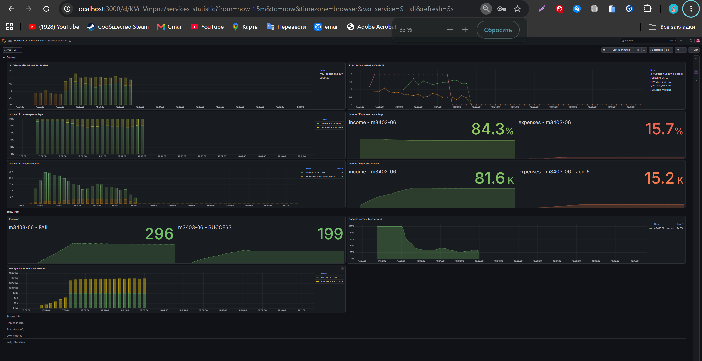

# Case-3: перегрузка платежного аккаунта acc-5

## Условия

```json
{
  "ratePerSecond": 2,
  "testCount": 500,
  "processingTimeMillis": 60000
}
```

| Параметр acc-5 | Значение |
|---|---:|
| Максимум параллельных запросов | 5 |
| Максимальная частота запросов | 3/с |
| Среднее время обработки | 4,9 с |
| Стоимость обращения | 30 |

Общие ориентиры курса: успешность более 97% и отношение доходов к расходам 93/7 или лучше. В теории отдельно оговорено, что эти показатели достижимы не во всех кейсах. Для case-3 требуется собственная метрика-счётчик с визуализацией в Grafana и объяснение результата через расчёты.

## Почему заданная нагрузка превышает возможности аккаунта

Пропускная способность ограничена одновременно частотой отправки и параллельностью:

```text
μ = min(3, 5 / 4,9) ≈ 1,02 оплаты/с
λ = 2 заказа/с
λ − μ ≈ 0,98 заказа/с
```

Аккаунт получает работу почти вдвое быстрее, чем способен её выполнять. Ограничение 3 запроса/с не является узким местом: все пять слотов заняты ожиданием ответов. FIFO-очередь и семафор соблюдают ограничения, но не увеличивают производительность провайдера.

500 заказов поступают примерно за 250 с. Для их обработки пяти слотам требуется примерно:

```text
500 × 4,9 / 5 = 490 с
```

У каждого клиента свой дедлайн: 60 с после поступления его запроса. Последний клиент перестаёт ждать примерно на 310-й секунде от начала теста. Даже оптимистичная оценка производительности за всё это время даёт:

```text
310 × 5 / 4,9 ≈ 316 оплат
316 / 500 ≈ 63%
```

Это оценка по среднему времени, а не строгий предел для любого случайного прогона. Она также игнорирует начальное заполнение слотов, работу БД, сети и приложения. Тем не менее она показывает, почему ожидать более 97% успешных оплат при заданных параметрах необоснованно.

При FIFO ожидание постепенно растёт. В приближённой непрерывной модели время до завершения заказа, пришедшего в момент t:

```text
W(t) ≈ 4,9 + (2 / 1,02 − 1) × t ≈ 4,9 + 0,96 × t
W(t) = 60 с при t ≈ 57 с
```

Примерно через минуту система начинает упираться в клиентские дедлайны. Это объясняет отличие от case-2: 100 заказов создают нагрузку только около 50 с, и очередь ещё может уложиться в допустимое ожидание.

## При каких параметрах тест мог бы пройти

Ниже — альтернативы, в каждой меняется только один параметр. Это расчётные ориентиры, а не разрешение менять условия case-3 и не подтверждённые результаты запусков.

| Изменение | Ближайшая расчётная граница | Вариант с запасом для проверки |
|---|---|---|
| Снизить входящую частоту, оставив 500 заказов и 60 с | Для конечного теста около 1,15 заказа/с с накоплением очереди; устойчивая граница ≈1,02/с | 1 заказ/с; запас небольшой, при вариативности задержек лучше ниже |
| Сократить число заказов, оставив 2/с и 60 с | Приближённо 110–115 заказов до достижения дедлайна последними клиентами | 100 заказов, как в case-2 |
| Увеличить клиентское ожидание, оставив 500 заказов и 2/с | Последним заказам нужно около 240–245 с вместо 60 с | 260 000 мс, затем проверить фактические задержки |
| Увеличить параллельность аккаунта | Оптимистичная оценка для конечного теста: `500 × 4,9 / 310 ≈ 7,9`, то есть 8 слотов; это погранично и не учитывает заполнение слотов | 9 слотов для конечного теста; 10 — минимальное целое число для устойчивых 2/с по среднему времени |

Граница для частоты получена из условия `4,9 + 500 × (4,9 / 5 − 1 / λ) ≤ 60`, для числа заказов — из `4,9 + N × (4,9 / 5 − 1 / 2) ≤ 60`. Эти формулы приближённые: дискретные партии из пяти запросов и случайные длительности сдвигают результат.

Все варианты описывают возможность уложиться во временные ограничения. Они не гарантируют финансовый критерий 93/7: он зависит от сумм успешных заказов и числа платных обращений. Даже при 500 успешных обращениях расходы составят 15 000; для доли доходов 93% нужен доход не менее `15 000 × 93 / 7 ≈ 199 286`.

## Графики локального запуска

Скриншот Grafana локального запуска case-3:



На нём видны:

- SUCCESS ≈199, FAIL ≈296;
- отказы CLIENT_TIMEOUT;
- доходы ≈81,6 тыс., расходы ≈15,2 тыс.; доли 84,3% / 15,7%.

По отображённым числам успешность за интервал составляет примерно `199 / (199 + 296) ≈ 40,2%`. Это не точные итоги 500 запросов: Grafana с `increase()` экстраполирует значения, а выбранный интервал может включать дополнительные данные. Показатель успешности за последнюю минуту (24,3% на скриншоте) также нельзя подменять успешностью всего прогона. Для точных итогов нужны исходные счётчики или журнал конкретного запуска.

<!--  -->

**Место для графика собственной метрики-счётчика.**

## Метрика и возможное улучшение

Для защиты полезно сопоставить скорости входящих заказов, отправленных оплат и успешных завершений. Собственные Counter можно визуализировать через `rate(...[1m])`, а рядом показать размер очереди и число активных оплат. Ожидаемая картина перегрузки: входящие около 2/с, обработка около 1/с, заняты все пять слотов, очередь и ожидание растут.

В текущем решении уже есть счётчик `payment.rejected`, а также метрики размера очереди, активных оплат и времени ожидания. Наличие отдельного графика собственного счётчика этим отчётом не подтверждается; место для него оставлено выше.

Возможная доработка — не отправлять оплаты, которым почти наверняка не хватит оставшегося времени до дедлайна. Для этого нужен прогноз длительности с запасом, проверенный по измерениям. Это может уменьшить бесполезные расходы и освободить слоты для ещё выполнимых заказов, но не устраняет дефицит пропускной способности.

## Вывод

При заданной нагрузке и среднем времени обработки достижение общего порога более 97% не поддерживается расчётами. Содержание case-3 — показать причину перегрузки, подтвердить её метриками и объяснить поведение системы. Расчётные альтернативы требуют отдельных прогонов; исходный тест в рамках подготовки этого отчёта повторно не запускался, код обработки оплат не менялся.
