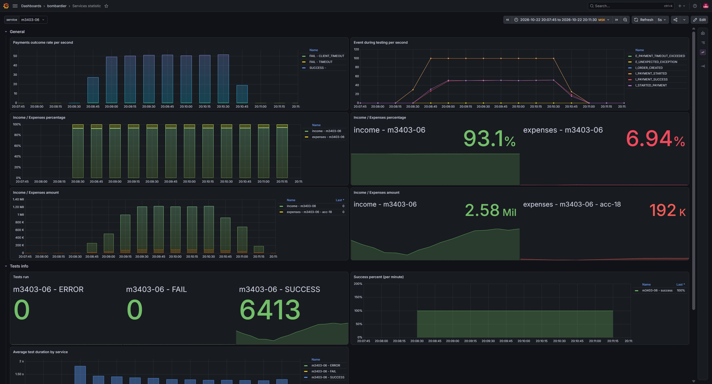

# Кейс 4: буферизация и back pressure

Для `acc-18` я запустил тест с исходными параметрами: **200 запросов/с, 6000 покупок, дедлайн 3000 мс**. Аккаунт принимает 110 запросов/с, обрабатывает платёж в среднем за секунду и берёт 30 за вызов.

Я ограничил количество незавершённых оплат. Если места закончились, магазин сразу отвечает **429**, а тестер повторяет запрос позже. Отказ происходит до изменения заказа и обращения к платёжной системе, поэтому денег не стоит. Back pressure включается свойством `payment.backpressure.enabled=true`; его можно отключить.

Размер буфера рассчитывается из лимитов аккаунта и бюджета времени:

```text
μ = min(rateLimitPerSec, parallelRequests / averageProcessingTimeSeconds)
C = ceil(μ × averageProcessingTimeSeconds)
Q = floor(μ × max(0, deadlineSeconds − processingUpperBoundSeconds − 1))
B = C + Q
```

Для этого кейса получились **110 мест и пауза повтора 1 с**. Верхняя граница обработки 2 с подтверждена кодом локального тестера и задаётся отдельно: одного среднего времени для её определения недостаточно. При запуске лимит постепенно растёт с одного места до 110, чтобы холодная JVM успевала прогреться на реальных запросах.

Перед сетевой отправкой скользящее окно ограничивает частоту до 110 стартов за секунду. Место в буфере освобождается после завершения всей оплаты. Для локальной проверки использовал HTTP/1.1 и очередь принятия TCP-соединений Jetty 1024: это убрало ошибки соединений при стартовом всплеске.

## Локальный результат

Прогон 22 октября 2026 года, **20:08:15–20:10:28 по Москве**, сразу после перезапуска JVM.

| Показатель | Результат |
|---|---:|
| SUCCESS | 5985 |
| FAIL / ERROR | 0 / 0 |
| Успешность среди полученных результатов | 100% |
| SUCCESS от всех 6000 запрошенных тестов | 99,75% |
| Минутная успешность, 27 непустых отсчётов | 100% |
| Доход | 2 406 603 |
| Расходы | 179 550 |
| Доходы / расходы | 93,0573% / 6,9427% |

У 15 тестов нет итогового результата в счётчиках и логе, поэтому я не записываю их в успешные. Даже консервативные 99,75% выше требуемых 97%. Генератор замедлялся по 429, поэтому весь прогон занял больше исходных 30 секунд подачи нагрузки.

Финансовый запас маленький, но лишних платных вызовов нет: **5985 × 30 = 179 550**. Увеличением очереди или изменением скорости этот запас не поднять при тех же заказах и тарифе. Порог 93/7 выполнен по точным счётчикам этого прогона; следующий случайный набор заказов может дать другую долю.

Точные значения сохранены в [local-result.json](local-result.json). Графики используют `increase()` и дают оценку, которая может отличаться от разности исходных счётчиков.



На скриншоте SUCCESS = 6413 — экстраполяция `increase()`, а не число выполненных покупок. Для вывода об успешности я использую точные 5985 результатов из счётчиков и лога.

## Удалённый запуск

Ветка `case-4` опубликована, запрос отправлен на учебный стенд с теми же параметрами `200 / 6000 / 3000` и аккаунтом `acc-18`. Первая попытка завершилась HTTP 500 (`Internal Server Error`), без ссылки на лог нового контейнера. Удалённый результат не подтверждён. Параметры и ответ сохранены в [remote-launch.json](remote-launch.json).

## Проверки

Прошли **24 целевых теста**: расчёт лимитов, заполнение и освобождение буфера, оба режима флага, HTTP 429 без изменения заказа, завершение оплаты, конкурентный rate limiting и настройка Jetty. `bootJar` собран успешно.

```powershell
.\gradlew.bat --offline test --tests ru.quipy.custom.JettyAcceptQueueTest --tests ru.quipy.custom.PaymentCompletionTest --tests ru.quipy.custom.SlidingWindowRateLimiterTest --tests ru.quipy.payments.logic.PaymentBackPressureTest --tests ru.quipy.payments.logic.PaymentFlowLimitsTest --tests ru.quipy.payments.logic.PaymentAdmissionBufferTest bootJar --console=plain
```
