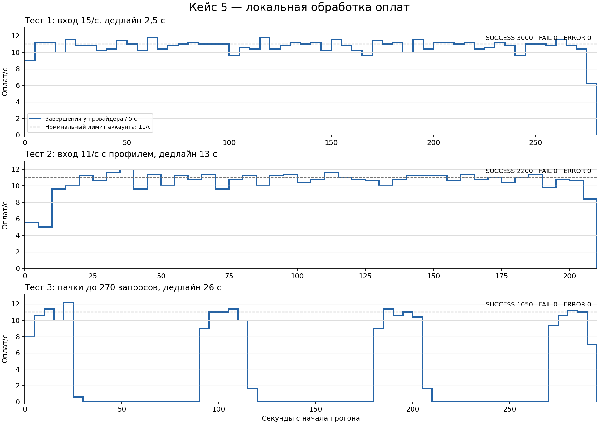

# Case 5: входной допуск по дедлайну

Решение для `acc-23` на ветке `case-5`, основанной на `case-3`.
Все измерения выполнены локальным учебным ранером. Пользовательские HTTP-файлы сохранены.

## Условия

| Тест | Входная частота | Число тестов | Клиентский дедлайн | Особенность |
|---|---:|---:|---:|---|
| 1 | 15/с | 3000 | 2,5 с | Постоянная перегрузка |
| 2 | 11/с | 2200 | 13 с | `profile: s_0.7_60` |
| 3 | 3/с | 1050 | 26 с | `runits: 90` |

Локальный `/external/accounts` вернул: 64 параллельных запроса, 11 запросов/с,
среднее время обработки 1 с, стоимость вызова 30. В коде локального тестера
обработка `acc-23` занимает случайное время от 0 до 2000 мс.

`runits` передаётся в `rateUnitSec`: бюджет генерации равен
`ratePerSecond * rateUnitSec`, окно — `rateUnitSec` секунд. Поэтому третий
тест допускает пачки до 270 запросов, а не равномерные 3 запроса каждую секунду.

Для проверки использован JAR работающего контейнера; SHA-256:
`f04144459afb6a973751b5ca5a8dee85ac3c595e97883904cf17eb929b125813`.

## Алгоритм

Входной допуск и отправка используют одно скользящее окно. Оно хранит
фактические старты последних HTTP-запросов. Отдельно учитываются идентификаторы
уже допущенных оплат, которые ещё не дошли до отправки.

Для нового запроса рассчитывается, когда освободится квота после всех
ожидающих оплат. Запрос принимается, если выполняется условие:

```text
ожидание квоты + 2000 мс обработки + 150 мс запаса <= оставшееся время клиента
```

При недостаточном времени возвращается HTTP 429 до изменения заказа и
создания оплаты. Запись об ожидающей оплате снимается при фактической отправке
или ошибке подготовки/исполнения. Это позволяет учитывать реальное накопление
работы, включая задержки БД, планировщика и ожидание квоты.

Отправка ограничена 11 стартами в скользящем окне 1000 мс.
Ожидание квоты выполняется в FIFO-порядке,
чтобы новые запросы не вытесняли старые при пробуждении потоков.

Унаследованная очередь сохраняет ёмкость 1000. Рабочих потоков не больше
числа параллельных запросов аккаунта. Убран периодический диспетчер с отдельной
паузой: ограничение частоты выполняется непосредственно перед HTTP-отправкой.
`payment.queue.wait` теперь включает ожидание квоты, а
`payment.admission.waiting` показывает все допущенные, но ещё не отправленные оплаты.

В этом учебном тестере `Retry-After` содержит абсолютный Unix timestamp в
миллисекундах. Возвращается время через 91 мс. По коду тестера 429 уменьшает
счётчик начатых тестов и замедляет генерацию новых, поэтому 429 учитываются
отдельно от итоговых FAIL.

## Почему случаи отличаются

- В тесте 1 короткий дедлайн позволяет принять примерно одну готовую квоту,
  а избыток нужно отклонять до накопления просроченных оплат.
- В тесте 2 дополнительное время позволяет принять пик и обработать его
  во время последующего спада нагрузки.
- В тесте 3 длинный дедлайн позволяет накопить большую часть пачки и затем
  отправлять её с максимально доступной частотой. При дедлайне 26 с и запасе
  2,15 с первоначально помещаются примерно 264 запроса.

Алгоритм и настройки одинаковы во всех трёх тестах; отличается доступный
запас ожидания из запроса клиента.

## Локальная конфигурация

```powershell
$env:PAYMENT_ACCOUNTS = 'acc-23'
$env:PAYMENT_ADMISSION_ENABLED = 'true'
$env:PAYMENT_ADMISSION_RATE = '11'
$env:PAYMENT_RATE_WINDOW_MILLIS = '1000'
$env:PAYMENT_ADMISSION_PROCESSING_RESERVE_MILLIS = '2150'
$env:SERVER_HTTP2_ENABLED = 'false'
```

Сервисное имя и токен передаются через существующие переменные окружения.
В конфигурации ветки входной допуск включён, HTTP/2 выключен,
аккаунт по умолчанию — `acc-23`. При включении допуска требуется один аккаунт;
настроенная частота допуска должна совпадать с его лимитом.

В локальной конфигурации HTTP/2 выключен. Ошибки `RST_STREAM` повторились
после длинных пауз в третьем тесте, до этапа оплаты. Для этой конфигурации
Jetty customizer допускает отсутствие h2c; остальные настройки HTTP/2
сохранены. Причина несовместимости HTTP/2 отдельно не установлена.

После перезапуска стенда полный третий сценарий дал 1038 SUCCESS и 12 ERROR:
`ConnectException` на этапе создания заказа, до входного допуска и оплаты.
Для проверки гипотезы о переполнении TCP-очереди при приходе пачки
`ServerConnector.acceptQueueSize` увеличен до 1024. Результат этого прогона
сохранён в `build/case5-validation/exact1000-test3-connect-errors`.
Повтор с очередью 1024 завершился без ошибок: 1050 SUCCESS. Это поддерживает
гипотезу, но не доказывает причину сетевых ошибок. Первые два теста ниже
выполнены до изменения TCP-очереди; после него повторён только третий.

## Результаты

Все три исходных сценария полностью выполнены с одинаковыми настройками
допуска и лимитера, с HTTP/1.1. TCP-очередь увеличена перед повтором теста 3.
Счётчики получены как разность значений локального тестера до и после каждого
запуска. Длительность — от запроса запуска до последнего результата/сообщения
об окончании генерации. Сбор метрик выполнялся после завершения ожидающих оплат.

| Тест | SUCCESS | FAIL | ERROR | HTTP 429 | Длительность | Доход | Расходы |
|---|---:|---:|---:|---:|---:|---:|---:|
| 1 | 3000 | 0 | 0 | 1148 | 278,343 с | 1 212 954 | 90 000 |
| 2 | 2200 | 0 | 0 | 27 | 209,549 с | 879 878 | 66 000 |
| 3 | 1050 | 0 | 0 | 6 | 294,460 с | 428 399 | 31 500 |

Всего 6250 успешных оплат и ровно 6250 платных обращений. Платных обращений
без клиентского SUCCESS в этих прогонах нет. Успешность каждого теста — 100%.
Доли доходов и расходов в их общей сумме:

| Тест | Доходы | Расходы |
|---|---:|---:|
| 1 | 93,093% | 6,907% |
| 2 | 93,022% | 6,978% |
| 3 | 93,151% | 6,849% |

В этих прогонах доля доходов выше 93% во всех трёх сценариях.
Расходы равны числу успешных оплат, умноженному на 30, а доход зависит от
случайных сумм заказов. Для доли дохода 93% требуется средняя сумма успешного
заказа не меньше `30 * 93 / 7 ≈ 398,57`. Лимитер не гарантирует этот порог
для каждого случайного набора. Параметры генерации и суммы заказов не менялись.

Результаты предыдущей конфигурации с окном 1010 мс сохранены в
[guard-1010-results.json](guard-1010-results.json). Первый тест ускорился
с 289,811 до 278,343 с. Разница доходов между прогонами зависит от случайных
сумм заказов и не является эффектом изменения окна.

Машиночитаемые данные: [local-results.json](local-results.json).
Сырые логи и снимки метрик сохранены в `build/case5-validation`.



График построен по уникальным завершённым транзакциям из логов провайдера,
усреднённым по пятисекундным интервалам. Число транзакций сверено с расходами.
Он показывает завершения, а ограничение 11/с применяется к стартам: случайные
длительности оплат дают небольшие колебания частоты завершений около этой линии.
В тесте 3 нулевые участки между пачками соответствуют отсутствию ожидающей
работы; при накопленной работе используется доступная мощность аккаунта.

Первый вариант с фиксированным бакетом 11/с и ёмкостью 11 дал:

| Тест | SUCCESS | FAIL | ERROR | Итог |
|---|---:|---:|---:|---|
| 1 | 490 | 2510 | 0 | Не справился с дедлайном |
| 2 | 2200 | 0 | 0 | 253 с, недостаточная скорость |
| 3, частичный | 36 | 0 | 307 | Простой и транспортные ошибки |

Его данные сохранены в [first-attempt-results.json](first-attempt-results.json).
Для входного прогноза нужны фактические старты: независимые виртуальные часы
накапливают расхождение из-за задержек отправки. В текущем решении прогноз
строится по реальному скользящему окну и FIFO-ожиданию.

## Проверка

```powershell
./gradlew.bat --offline bootJar
```

Поведение проверено полными запусками трёх исходных сценариев через
`http://localhost:1234/test/run`. Для проверки используется локальный учебный ранер.
